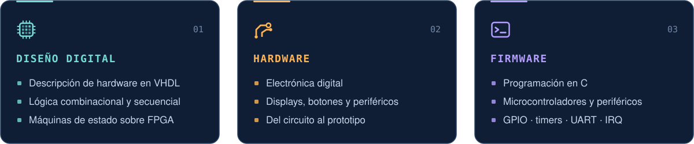
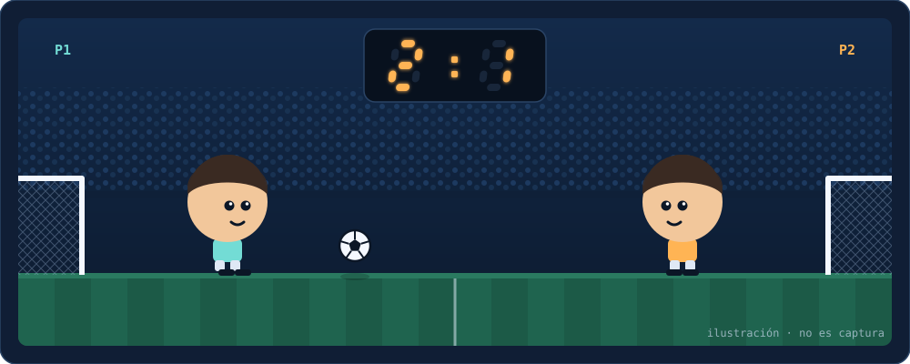
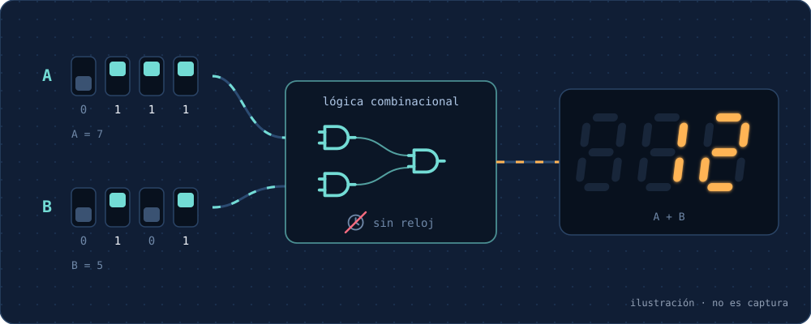

  

<h1 align="center">Juan Sebastian Calderon Lara</h1>

  Estudiante de <b>Ingeniería Electrónica</b> en la <b>Pontificia Universidad Javeriana</b>. 
  Me apasiona el <b>diseño digital</b>: describir hardware en <b>VHDL</b> y verlo correr en una <b>FPGA</b>. 
  También me mueve el lado del <b>hardware</b> y el <b>firmware en C</b> para microcontroladores.

  
  
  

## Sobre mí

- Estudio **Ingeniería Electrónica** en la Pontificia Universidad Javeriana.
- Lo mío es pensar en compuertas, registros y máquinas de estado, describirlos en **VHDL** y verlos funcionar en una **FPGA**.
- Programo en **C** y lo quiero llevar al **firmware**: código que vive pegado al hardware, en microcontroladores.
- Ahora mismo: subiendo mis proyectos de diseño digital y metiéndome de lleno en microcontroladores.

## Lo que me interesa

  

## Tecnologías

### Diseño digital

 

Lógica combinacional y secuencial, máquinas de estado e implementación sobre FPGA.

### Programación

### Hardware y firmware (explorando)

  

### Herramientas

## Proyectos destacados

### Head Soccer en VHDL

  

Versión en hardware del clásico juego de cabezones. Toda la lógica del juego (movimiento de los jugadores, física del balón, goles y marcador) está descrita en **VHDL** e implementada sobre una **FPGA**, organizada con máquinas de estado.

`VHDL` `FPGA` `Máquinas de estado` `Videojuego`

### Calculadora 100 % combinacional

  

Calculadora construida solo con lógica combinacional: **sin reloj y sin registros**, únicamente compuertas. Las entradas llegan por interruptores y el resultado sale directo a displays de 7 segmentos.

`VHDL` `Lógica combinacional` `Display 7 segmentos`

<!-- Cuando subas la calculadora, cambia la línea anterior por:

-->

## Actividad en GitHub

  

## Contacto

- Correo institucional: [calderonljsebastian@javeriana.edu.co](mailto:calderonljsebastian@javeriana.edu.co)
- Correo personal: [tatancalderonlara@hotmail.com](mailto:tatancalderonlara@hotmail.com)

  

